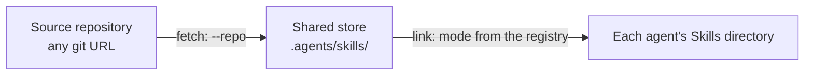

# agents-env

[English](README.md) | [简体中文](README.zh-CN.md)

One set of Skills and one set of Instructions, wired into every AI agent.

agents-env keeps Skills in one shared store, `.agents/skills/`, and rules in one file, `AGENTS.md`. It then connects both to each agent's own directories, as a registry declares. Skills are linked with relative symlinks. Instructions get small entry files that point back to `AGENTS.md`. The same mechanism works at user scope and at project scope.

---

## Why

Each agent keeps its own conventions. Skills go under `.<agent>/skills/`, and rules go into `<AGENT>.md` or `.<agent>/rules/<entry-file>`. Maintaining this by hand usually goes wrong in these ways:

- **Copies drift apart.** The same Skill is copied into several directories, and an update reaches only some of them.
- **A quick `ln -s` does damage.** A whole-directory link hides the agent's built-in Skills. An absolute link breaks when a directory moves or the setup moves to another machine.
- **Backups leak into git.** `.bak` files left by project-level overwrites show up in `git status` and can be committed by accident.
- **Every new agent starts over.** Each one needs its read location looked up and its links written again.

agents-env moves these facts into one registry, `config/agents.json`. It records where each agent reads from and how to connect to it. The scripts only carry out what the registry declares, so supporting a new agent means editing the registry, not the scripts.

## How it works

Skills take two steps. Each step can run on its own.

- **Fetch** copies Skills from a source repository into the shared store. It runs only when you pass `--repo`. It adds new Skills and leaves existing ones alone.
- **Link** connects the store to each agent. It always runs, so it can rebuild links without fetching anything.



The labels on the arrows name the step behind each one. The registry decides where the store is, which agents exist, and which link mode each agent gets.

After linking with mode `link-each`, the disk looks like this:

```text
~/.agents/skills/                       shared store
├── alpha-skill/
└── beta-skill/

~/.<agent>/skills/
├── alpha-skill -> ../../.agents/skills/alpha-skill
├── beta-skill  -> ../../.agents/skills/beta-skill
└── built-in-skill/                     real directory, left untouched
```

Links are relative, so they keep working after the whole tree moves.

Instructions follow the same idea with a different mechanism. `setup-instructions.sh` writes one small entry file per agent, and each entry points to `AGENTS.md`. The rules stay in one place.

## Scopes

| | User `--scope user` | Project `--scope project` |
| :--- | :--- | :--- |
| Root | `$HOME` | Repository root (current directory by default, or `--target`) |
| Shared Skills store | `~/.agents/skills/` | `<repo>/.agents/skills/` |
| Instructions entry | e.g. `~/.<agent>/<entry-file>` | e.g. `<AGENT>.md` or `.<agent>/rules/<entry-file>` |
| Link mode | Declared per agent in the registry | Declared per agent in the registry |

Choose the scope by who should use the Skills:

- **User scope** makes them available in every project on this machine.
- **Project scope** keeps them inside one repository. The store is `.agents/skills/` in that repository, so whether to commit it is up to the project.

The store location comes from `shared.skills_root` in the registry. The scripts don't assume it.

## Scenarios

### Use your own Skills in every agent

Fetch from your repository into the user store, then link:

```bash
curl -fsSL "https://raw.githubusercontent.com/xianghongai/agents-env/main/setup-skills.sh" \
  | bash -s -- --scope user --repo https://github.com/someone/my-skills.git
```

From a checkout of this repository, run `./setup-skills.sh` instead. The registry is then read from the checkout, and only the `--repo` clone uses the network. If the commands are installed, run `setup-skills` directly, as described in [Install as a command](#install-as-a-command).

### Share Skills with a project team

From the root of the target repository:

```bash
curl -fsSL "https://raw.githubusercontent.com/xianghongai/agents-env/main/setup-skills.sh" \
  | bash -s -- --scope project --repo https://github.com/someone/team-skills.git
```

Skills land in the repository's `.agents/skills/`. Links go to each agent's project directory, as the registry declares for that agent.

### Take only some Skills from a large collection

```bash
curl -fsSL "https://raw.githubusercontent.com/xianghongai/agents-env/main/setup-skills.sh" \
  | bash -s -- --scope user --repo https://github.com/someone/mixed-repo.git \
    --path skills/.curated --skill alpha-skill --skill beta-skill
```

`--path` limits where the script looks, and `--skill` limits which Skills it takes. An unknown name stops the run before anything is written.

### Pull an upstream update

Run the same fetch command with `--force`:

```bash
curl -fsSL "https://raw.githubusercontent.com/xianghongai/agents-env/main/setup-skills.sh" \
  | bash -s -- --scope user --repo https://github.com/someone/my-skills.git --force
```

`--force` replaces each Skill with the same name as a whole. Nothing is merged. The original moves to `<store>.local.bak/<name>`, so it can be compared or moved back.

### Rebuild links without fetching

Pass only `--scope`:

```bash
curl -fsSL "https://raw.githubusercontent.com/xianghongai/agents-env/main/setup-skills.sh" \
  | bash -s -- --scope user
```

Use it after the registry changes, or after a Skill was placed into the store by hand. Links left pointing at Skills that were renamed or deleted are cleaned up.

### Test a Skill you are writing

Commit the Skill, then point `--repo` at the local directory:

```bash
./setup-skills.sh --scope user --repo ~/src/my-skill-repo
```

Git clones only committed content, so commit before each test.

## Install as a command

Every `curl ... | bash` run downloads the script and the registry again. Install both scripts as commands once, and you can run them directly:

```bash
curl -fsSL "https://raw.githubusercontent.com/xianghongai/agents-env/main/setup-skills.sh" \
  | bash -s -- --install
```

Then:

```bash
setup-skills --scope user --repo https://github.com/someone/my-skills.git
setup-instructions --scope user
```

### Where things go

| What | Location |
| :--- | :--- |
| `setup-skills`, `setup-instructions` | `~/.local/bin/` |
| Registry `config/agents.json` and templates | `~/.local/share/agents-env/` |

Both commands are always installed together and share one registry and one set of templates, so their versions cannot drift apart. Installing changes no shell configuration. If `~/.local/bin` is not in your `PATH`, the install prints a note. Add that directory to your shell configuration.

### Update

```bash
setup-skills --update
```

`--update` refreshes both commands and their data to the latest version on the `main` branch. It updates only what is already installed and never adds a missing command. Changed files are replaced, and the originals are kept as `.local.bak`. Either command gives the same result.

The update does not ask for confirmation, so preview it first:

```bash
setup-skills --update --dry-run
```

`--install` and `--update` accept only `--branch` and `--dry-run` alongside them. Other options are rejected.

To refresh only the registry, leaving the scripts and templates as they are, use `update-registry`:

```bash
setup-skills update-registry --dry-run
setup-skills update-registry
```

The new registry may reference templates that are not installed yet. In that case the command stops before writing anything and asks for `--update` first.

### Where the data comes from

An installed command gets the registry in this order:

1. The checkout: the directory given with `--source`, or the checkout that contains the script.
2. The installed data, used when the command runs directly from `~/.local/bin`. No network access is needed.
3. GitHub, downloaded as before.

A script run through a pipe (`curl ... | bash`) is always the latest version, so it doesn't use the installed data. With `--branch`, the registry comes from that branch however the script runs.

### Uninstall

```bash
rm -f ~/.local/bin/setup-skills ~/.local/bin/setup-instructions ~/.local/bin/*.local.bak
rm -rf ~/.local/share/agents-env
```

Uninstalling removes the commands and their data only. Links and entry files already created stay in place, so remove them separately if you need to.

## Skills in detail

### Where Skills come from

The source repository is checked in this order, and the first match wins:

1. A `SKILL.md` at the root. The whole repository is one Skill.
2. Otherwise, every subdirectory of `skills/` that contains a `SKILL.md`. Other entries are ignored.

`--path <subdir>` changes where the search starts. If that directory has a `SKILL.md` directly, only it is taken. Otherwise its immediate subdirectories that contain a `SKILL.md` are taken. `--path` accepts only a relative path inside the repository.

`--ref` selects a branch, tag or commit. It defaults to the repository's default branch.

A Skill's installed name is the `name` field in its `SKILL.md` frontmatter. Without it, the directory name is used, or the repository name for a single-Skill repository. Invalid or duplicate names abort the run before anything is written.

### Link modes

The registry declares a `mode` for each agent, separately for each scope:

| mode | What it does |
| :--- | :--- |
| `link-dir` | Links the agent's whole Skills directory to the store |
| `link-each` | Creates one symlink per Skill in the store, alongside the agent's own Skills |
| `none` | Creates no links, and removes symlinks in that directory that point into the store |

Linking only considers directories in the store that contain a `SKILL.md`.

<details>
<summary><strong>Link results for each existing state</strong></summary>

<br>

`link-each` works per Skill name in the store:

| Already at that name | Result |
| :--- | :--- |
| Nothing | A relative symlink is created |
| A correct relative symlink into the store | Left as is |
| A symlink into the store written differently (for example, an absolute path) | Replaced with the correct relative symlink |
| A symlink pointing outside the store, broken or not | Skipped |
| A real directory or file | Skipped |

Symlinks in the agent's directory that point into the store but no longer resolve to a Skill are removed. Alias symlinks are kept as long as they still resolve to a Skill. Everything else is left alone, such as the agent's built-in Skills and symlinks pointing elsewhere. To clean up other dangling symlinks, see [Clean up dangling links](#clean-up-dangling-links).

`link-dir` works on the agent's Skills directory as a whole:

| The directory is | Result |
| :--- | :--- |
| Missing | A relative whole-directory symlink is created |
| A correct relative symlink into the store | Left as is |
| A symlink into the store written differently | Replaced with the correct relative symlink |
| A symlink pointing outside the store | Skipped; nothing is linked inside it |
| A real directory that is empty or holds only symlinks into the store | Those symlinks and the empty directory are removed, and a whole-directory symlink takes their place |
| A real directory with other content | Falls back to per-Skill links, handled as in the `link-each` table |

`none` removes the symlinks in that directory that point into the store and leaves everything else alone. It removes symlinks only, never directories.

</details>

<details>
<summary><strong>Incremental updates and backups</strong></summary>

<br>

- Skills with new names are added. Same-named Skills are skipped by default and replaced only with `--force`.
- Replacement swaps the whole Skill, and nothing is merged. The original first moves to `<store>.local.bak/<name>`, outside the store, and then the new version is copied in.
- Backups stay outside the store because agents that read the store natively, or link to it as a whole directory, would otherwise load a backup as a duplicate Skill. Legacy `<name>.local.bak` backups left inside the store by older versions are moved out during linking.

</details>

### Clean up dangling links

A dangling symlink exists, but its target does not. Normal runs only remove symlinks that point into the store and no longer resolve to a Skill (see above). The `prune` subcommand also removes dangling symlinks from these places:

- The direct children of each agent's Skills directory.
- The direct children of the store.

Links pointing outside the store are included. `prune` only removes links: it does not fetch and does not link. Real directories and files are never touched, and nothing is removed recursively.

If a dangling link in the store has the same name as a Skill being fetched, the fetch fails. Run `prune` before fetching.

A link to a target that is only temporarily unavailable, such as an unmounted disk, looks dangling too. Preview first:

```bash
setup-skills prune --scope user --dry-run
```

---

## Instructions

`setup-instructions.sh` writes an entry file for each agent that points to `AGENTS.md`. Entry content is rendered from `templates/`. A few agents need frontmatter or an entirely different body, and the registry declares the template variant for them. Agents that read `AGENTS.md` natively need no entry file, so none is written for them.

- An entry file with identical content is skipped. One with different content is backed up as `<file>.local.bak` before being overwritten.
- The script doesn't check whether an agent is installed. You can set up entries first and install the agent later.
- Without arguments, the script prints its help. `interactive` starts the wizard, and works from a pipe too: `curl ... | bash -s -- interactive`. Other arguments make the run non-interactive, and the script asks for confirmation once unless `--force` is given.

Once the commands are installed, run `setup-instructions --scope user` directly, as described in [Install as a command](#install-as-a-command).

User scope:

```bash
curl -fsSL "https://raw.githubusercontent.com/xianghongai/agents-env/main/setup-instructions.sh" \
  | bash -s -- --scope user
```

Project scope (`cd` into the target repository first):

```bash
curl -fsSL "https://raw.githubusercontent.com/xianghongai/agents-env/main/setup-instructions.sh" \
  | bash -s -- --scope project
```

Limit the run to some agents with a comma-separated list of registry agent IDs:

```bash
curl -fsSL "https://raw.githubusercontent.com/xianghongai/agents-env/main/setup-instructions.sh" \
  | bash -s -- --scope project --agent <agent-id>,<agent-id>
```

---

## Safety

- **Never overwrites your own entries.** A same-named real directory, or a same-named symlink that points outside the store, is skipped and reported.
- **Validates before writing.** All checks run before anything is written, so a failure leaves no partial result.
- **Reversible.** `--force` moves originals aside, and changed entry files are backed up first.
- **Previews first.** Both scripts print the full plan and act only after confirmation during ordinary runs. `--dry-run` shows the plan and makes no changes.
- **Verify before replacing.** `--install` and `--update` download and check every file first, and stop completely if any file fails. They don't ask for confirmation, so preview them with `--dry-run` first.
- **Keeps backups out of git.** The `.local.bak` suffix matches the `*.local.*` rule found in common `.gitignore` files.
- **Dangling links only.** `prune` removes symbolic links only, never directories, and never recurses.
- **Relative symlinks.** Links keep working after the directory tree is moved.

## Requirements

| Dependency | When it's needed |
| :--- | :--- |
| Bash 3.2+ or Zsh | Always |
| `jq` | Always, to read the registry |
| `git` | When `setup-skills.sh` fetches Skills with `--repo` |
| `curl` or `wget` | When a script runs outside a checkout of this repository (for example, `curl \| bash`), and for `--install` and `--update`, to download the registry and templates |

Each script is self-contained and needs no Node.js or Python. When a script runs inside a checkout of this repository, or `--source` points to one, it uses the local files and doesn't touch the network for the registry.

## Command reference

### `setup-skills.sh`

| Option | Purpose |
| :--- | :--- |
| `--scope <user\|project>` | Scope |
| `-r, --repo <url>` | Source repository, any URL git can clone. Without it, only links |
| `--ref <branch\|tag\|commit>` | Ref to fetch. Defaults to the repository's default branch |
| `--path <subdir>` | Look for Skills only in this subdirectory. Requires `--repo` |
| `--skill <name>` | Fetch only the named Skill. Repeatable. Requires `--repo` |
| `-t, --target <dir>` | Scope root. Defaults to `$HOME` for user, the current directory for project |
| `-s, --source <dir>` | Local checkout for the registry. Downloaded if omitted |
| `--branch <name>` | Branch to download the registry from. Defaults to `main` |
| `--dry-run` | Show the plan only |
| `-y, --yes` | Skip the confirmation. Required without a terminal |
| `-f, --force` | Replace same-named Skills. Implies `--yes` |
| `prune` (subcommand) | Remove dangling symlinks (targets that do not exist) only. Fetches and links nothing. Accepts only `--scope`, `--target`, `--source`, `--branch`, `--dry-run` and `--yes` |
| `--install` | Install both commands into `~/.local/bin`, with their data in `~/.local/share/agents-env`. Accepts only `--branch` and `--dry-run` |
| `--update` | Update the installed commands and their data. Accepts only `--branch` and `--dry-run` |
| `interactive` | Start the interactive wizard, also as `-i` or `--interactive`. Takes no other arguments |
| `help` | Show help and exit, same as no arguments, `-h` or `--help` |
| `update-registry` | Refresh only the installed registry (`config/agents.json`). Accepts only `--branch` and `--dry-run` |
| `-h, --help` | Show help and exit |

### `setup-instructions.sh`

| Option | Purpose |
| :--- | :--- |
| `--scope <user\|project>` | Scope |
| `-a, --agent <id>` | Comma-separated agent IDs to limit the run to. Defaults to all agents in the registry |
| `-t, --target <dir>` | Scope root. Defaults to `$HOME` for user, the current directory for project |
| `-s, --source <dir>` | Local checkout for the registry. Downloaded if omitted |
| `--branch <name>` | Branch to download from. Defaults to `main` |
| `--dry-run` | Show the plan only |
| `-f, --force` | Skip the confirmation. Required without a terminal |
| `--install` | Install both commands into `~/.local/bin`, with their data in `~/.local/share/agents-env`. Accepts only `--branch` and `--dry-run` |
| `--update` | Update the installed commands and their data. Accepts only `--branch` and `--dry-run` |
| `interactive` | Start the interactive wizard, also as `-i` or `--interactive`. Takes no other arguments |
| `help` | Show help and exit, same as no arguments, `-h` or `--help` |
| `update-registry` | Refresh only the installed registry (`config/agents.json`). Accepts only `--branch` and `--dry-run` |
| `-h, --help` | Show help and exit |

Adding or changing an agent is covered in the [registry guide](config/README.md).

---

## License

MIT
