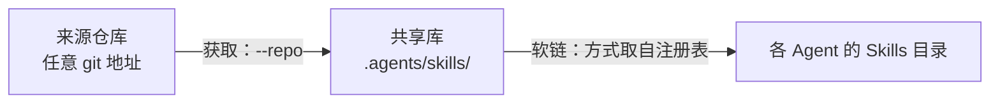

# agents-env

[English](README.md) | [简体中文](README.zh-CN.md)

一份 Skills、一份 Instructions，接入所有 AI Agent。

agents-env 把 Skills 集中放进一个共享库 `.agents/skills/`，把规则集中放进一个文件 `AGENTS.md`，再按注册表把两者接到各 Agent 自己的目录里。Skills 用相对软链接入，Instructions 写入指向 `AGENTS.md` 的小型入口文件。用户级与项目级使用同一套机制。

---

## 为什么需要它

每个 Agent 都有自己的约定：Skills 放在 `.<agent>/skills/`，规则写进 `<AGENT>.md` 或 `.<agent>/rules/<入口文件>`。手动维护通常会出现以下问题：

- **副本各自漂移**：同一个 Skill 复制到多个目录，更新时只改到一部分。
- **随手 `ln -s` 会误伤**：整目录软链会盖住 Agent 自带的系统 Skill。绝对路径的软链在目录移动或换到另一台机器后失效。
- **备份混进版本库**：项目级覆盖留下的 `.bak` 文件出现在 `git status` 里，容易被误提交。
- **新增 Agent 要从头来**：每接入一个 Agent，都要重新查它读哪里，再手写一遍链接。

agents-env 把这些事实集中到注册表 `config/agents.json`：记录每个 Agent 从哪里读取、以什么方式接入。脚本只执行注册表中的声明，因此接入新 Agent 只需修改注册表，不需要改脚本。

## 工作方式

Skills 分两步，每一步都可以单独运行：

- **获取**：把来源仓库中的 Skill 增量复制进共享库。只有传入 `--repo` 时才会执行；新名称的 Skill 直接添加，已有的保持不动。
- **软链**：把共享库接到每个 Agent。每次都会执行，所以不获取也能重建链接。



箭头上的标签说明了每条箭头对应的步骤。注册表决定共享库在哪里、有哪些 Agent，以及每个 Agent 采用哪种软链方式。

以 `link-each` 方式软链之后，磁盘上的结构如下：

```text
~/.agents/skills/                    共享库
├── alpha-skill/
└── beta-skill/

~/.<agent>/skills/
├── alpha-skill -> ../../.agents/skills/alpha-skill
├── beta-skill  -> ../../.agents/skills/beta-skill
└── built-in-skill/                  实体目录，原样保留
```

软链使用相对路径，整棵目录树移动之后依然有效。

Instructions 的思路相同，机制不同。`setup-instructions.sh` 为每个 Agent 写入一个小型入口文件，入口都指向 `AGENTS.md`，规则只维护一份。

## 范围

| | 用户级 `--scope user` | 项目级 `--scope project` |
| :--- | :--- | :--- |
| 根目录 | `$HOME` | 仓库根（默认当前目录，可用 `--target` 指定） |
| Skills 共享库 | `~/.agents/skills/` | `<仓库>/.agents/skills/` |
| Instructions 入口 | 形如 `~/.<agent>/<入口文件>` | 形如 `<AGENT>.md` 或 `.<agent>/rules/<入口文件>` |
| 软链方式 | 由注册表为每个 Agent 声明 | 由注册表为每个 Agent 声明 |

选择范围的依据是谁需要使用这些 Skill：

- **用户级**对本机上的所有项目生效。
- **项目级**只在一个仓库内生效。共享库是仓库里的 `.agents/skills/`，是否提交到版本库由项目决定。

共享库位置由注册表的 `shared.skills_root` 声明，脚本不内置。

## 常见场景

### 个人 Skill 供所有 Agent 使用

把个人仓库中的 Skill 获取进用户级共享库，并完成软链：

```bash
curl -fsSL "https://raw.githubusercontent.com/xianghongai/agents-env/main/setup-skills.sh" \
  | bash -s -- --scope user --repo https://github.com/someone/my-skills.git
```

在本仓库的检出中运行时，改用 `./setup-skills.sh`。此时注册表读取检出中的本地文件，只有克隆 `--repo` 时才访问网络。已安装为命令时，直接运行 `setup-skills`，见「安装为命令」。

### 团队共享项目级 Skill

在目标仓库的根目录运行：

```bash
curl -fsSL "https://raw.githubusercontent.com/xianghongai/agents-env/main/setup-skills.sh" \
  | bash -s -- --scope project --repo https://github.com/someone/team-skills.git
```

Skill 落在仓库的 `.agents/skills/` 中。软链写入各 Agent 的项目级目录，具体位置由注册表声明。

### 只取大仓库中的一部分

```bash
curl -fsSL "https://raw.githubusercontent.com/xianghongai/agents-env/main/setup-skills.sh" \
  | bash -s -- --scope user --repo https://github.com/someone/mixed-repo.git \
    --path skills/.curated --skill alpha-skill --skill beta-skill
```

`--path` 限定在哪里查找，`--skill` 限定取哪些 Skill。名称不存在时，在任何写入之前就中止。

### 同步上游更新

在获取命令后加上 `--force`：

```bash
curl -fsSL "https://raw.githubusercontent.com/xianghongai/agents-env/main/setup-skills.sh" \
  | bash -s -- --scope user --repo https://github.com/someone/my-skills.git --force
```

`--force` 对同名 Skill 做整份替换，不做合并。原件先移到 `<共享库>.local.bak/<名称>`，可以比对，也可以移回去。

### 不获取，只重建链接

只带 `--scope`：

```bash
curl -fsSL "https://raw.githubusercontent.com/xianghongai/agents-env/main/setup-skills.sh" \
  | bash -s -- --scope user
```

适用于注册表有改动，或手动把 Skill 放进共享库之后。指向已改名或删除的 Skill 的失效软链会被清理。

### 调试正在编写的 Skill

先提交，再把 `--repo` 指向本地目录：

```bash
./setup-skills.sh --scope user --repo ~/src/my-skill-repo
```

Git 只克隆已提交的内容，所以每次测试前都要先提交。

## 安装为命令

每次都用 `curl ... | bash` 运行时，脚本与注册表都会重新下载。把两个脚本装成命令之后，就可以直接运行：

```bash
curl -fsSL "https://raw.githubusercontent.com/xianghongai/agents-env/main/setup-skills.sh" \
  | bash -s -- --install
```

装好之后：

```bash
setup-skills --scope user --repo https://github.com/someone/my-skills.git
setup-instructions --scope user
```

### 安装位置

| 内容 | 位置 |
| :--- | :--- |
| `setup-skills`、`setup-instructions` | `~/.local/bin/` |
| 注册表 `config/agents.json` 与模板 | `~/.local/share/agents-env/` |

两个命令总是成对安装，共用同一份注册表与模板，版本不会错位。安装不修改任何 shell 配置。若 `~/.local/bin` 不在 `PATH` 中，安装结束时会给出提示，请把该目录加入 shell 配置。

### 更新

```bash
setup-skills --update
```

`--update` 把两个命令与数据更新到 `main` 分支的最新版。只更新已安装的部分，不会补装缺失的命令。有变化的文件直接替换，原件保留为 `.local.bak`。两个命令的 `--update` 效果相同。

更新不询问确认，建议先预览：

```bash
setup-skills --update --dry-run
```

`--install` 与 `--update` 只能和 `--branch`、`--dry-run` 同用，其它选项会被拒绝。

### 数据来源

安装后的命令按以下顺序取得注册表：

1. 检出目录：`--source` 指定的目录，或脚本所在的检出。
2. 已安装的数据：从已安装的命令直接运行时使用，不联网。
3. GitHub 下载。

管道执行（`curl ... | bash`）拿到的脚本永远是远端最新版，因此不使用已安装的数据。显式指定 `--branch` 时，无论以何种方式运行，都从该分支下载。

### 卸载

```bash
rm -f ~/.local/bin/setup-skills ~/.local/bin/setup-instructions ~/.local/bin/*.local.bak
rm -rf ~/.local/share/agents-env
```

卸载只删除命令与数据。已经建立的软链和入口文件保持不变，需要时另行清理。

## Skills 详解

### 来源如何识别

脚本按以下顺序识别来源仓库，命中即停：

1. 仓库根下直接有 `SKILL.md`，整个仓库就是一个 Skill。
2. 否则取 `skills/` 下含 `SKILL.md` 的子目录，其它条目忽略。

`--path <子目录>` 改变识别的起点。该目录下直接有 `SKILL.md` 时只取它一个，否则取其直接子目录中含 `SKILL.md` 的。`--path` 只接受仓库内的相对路径。

`--ref` 指定分支、标签或提交，默认取仓库的默认分支。

Skill 的落地名称取 `SKILL.md` frontmatter 中的 `name` 字段；缺省时用目录名，单 Skill 仓库用仓库名。名称不合法或出现重名时，在任何落盘之前中止。

### 软链方式

注册表为每个 Agent 的每个范围各自声明一个 `mode`：

| mode | 作用 |
| :--- | :--- |
| `link-dir` | 把 Agent 的整个 Skills 目录软链到共享库 |
| `link-each` | 为共享库中的每个 Skill 各建一条软链，与 Agent 自带的 Skills 共存 |
| `none` | 不建链接，并清理该目录下指向共享库的软链 |

软链阶段只处理共享库中含 `SKILL.md` 的目录。

<details>
<summary><strong>各种现状下的软链结果</strong></summary>

<br>

`link-each` 以共享库中的每个 Skill 名称为单位：

| 同名现状 | 结果 |
| :--- | :--- |
| 没有 | 新建相对软链 |
| 指向共享库的正确相对软链 | 不动 |
| 指向共享库，但路径写法不同（如绝对路径） | 改为正确的相对软链 |
| 指向共享库之外的软链，无论是否有效 | 跳过 |
| 实体目录或文件 | 跳过 |

此外，Agent 目录中指向共享库、但已解析不到 Skill 的软链会被删除，例如 Skill 改名或删除后留下的。别名软链只要还能解析到 Skill 就保留。其它条目一概不动，例如 Agent 自带的 Skill 和指向别处的软链。需要清理其它悬空软链时，见「清理悬空软链」。

`link-dir` 以 Agent 的 Skills 目录整体为单位：

| 该目录现状 | 结果 |
| :--- | :--- |
| 不存在 | 新建整目录相对软链 |
| 指向共享库的正确相对软链 | 不动 |
| 指向共享库，但路径写法不同 | 改为正确的相对软链 |
| 指向共享库之外的软链 | 跳过，也不往目录里建链 |
| 实体目录，为空或只含指向共享库的软链 | 删除这些软链和空目录，换成整目录软链 |
| 实体目录，含其它内容 | 回退为逐项软链，按 `link-each` 的表处理 |

`none` 删除该目录下指向共享库的软链，其它条目不动。只删软链，不删目录。

</details>

<details>
<summary><strong>增量更新与备份</strong></summary>

<br>

- 名称不同的 Skill 直接新增；名称相同的默认跳过，加 `--force` 才替换。
- 替换是整份替换，不做合并。原件先移到共享库之外的 `<共享库>.local.bak/<名称>`，新版再完整落入。
- 备份不放在共享库内，否则原生读取共享库、或整目录软链到共享库的 Agent 会把备份当成同名 Skill 加载。旧版本遗留在库内的 `<名称>.local.bak` 会在软链阶段迁出。

</details>

### 清理悬空软链

悬空软链指软链本身存在、目标却不存在。常规运行只清理指向共享库、且已解析不到 Skill 的软链（见上文）。`prune` 子命令还会清理以下位置中目标不存在的软链：

- 各 Agent 的 Skills 目录的直接子项。
- 共享库的直接子项。

指向共享库之外的软链也包括在内。`prune` 只删软链，不获取，也不建链；实体目录与普通文件一概不碰，也不递归进子目录。

共享库里若有与待获取 Skill 同名的悬空软链，获取会失败，因此应先运行 `prune`。

目标只是暂时不可达（例如磁盘未挂载）的软链同样看起来是悬空的，所以建议先预览：

```bash
setup-skills prune --scope user --dry-run
```

---

## Instructions

`setup-instructions.sh` 为各 Agent 写入指向 `AGENTS.md` 的入口文件。入口内容由 `templates/` 渲染；少数 Agent 需要 frontmatter 或整份不同的正文，由注册表声明对应的模板变体。原生读取 `AGENTS.md` 的 Agent 不需要入口文件，脚本不会为它写入。

- 内容一致的入口文件直接跳过；内容不同的先备份为 `<文件名>.local.bak`，再覆盖。
- 不检测 Agent 是否已安装，可以先把入口铺好，之后再安装 Agent。
- 不带参数时进入交互向导；带参数时为非交互模式，执行前请求一次确认，加 `--force` 则跳过确认。

安装为命令后，直接运行 `setup-instructions --scope user` 即可，见「安装为命令」。

用户级：

```bash
curl -fsSL "https://raw.githubusercontent.com/xianghongai/agents-env/main/setup-instructions.sh" \
  | bash -s -- --scope user
```

项目级（先 `cd` 进目标仓库）：

```bash
curl -fsSL "https://raw.githubusercontent.com/xianghongai/agents-env/main/setup-instructions.sh" \
  | bash -s -- --scope project
```

只处理部分 Agent，用逗号分隔注册表中的 Agent 标识：

```bash
curl -fsSL "https://raw.githubusercontent.com/xianghongai/agents-env/main/setup-instructions.sh" \
  | bash -s -- --scope project --agent <agent-id>,<agent-id>
```

---

## 安全性

- **不覆盖自己的条目**：Agent 目录里的同名实体目录、指向共享库之外的同名软链，一律跳过并报告。
- **先校验，后写入**：所有校验都在落盘之前完成，失败时不留半成品。
- **改动可回退**：`--force` 把原件移到一旁，入口文件内容不同时先备份。
- **先预览，后执行**：两个脚本的常规运行都先列出完整计划，确认后才动手。`--dry-run` 只展示计划，不做任何修改。
- **自更新先校验，后替换**：`--install` 与 `--update` 先下载并校验全部文件，任何一个未通过就整体中止。它们不询问确认，因此先用 `--dry-run` 预览。
- **备份不进版本库**：`.local.bak` 后缀命中常见 `.gitignore` 中的 `*.local.*` 规则。
- **悬空软链只删软链**：`prune` 只删符号链接，不删目录，也不递归。
- **相对软链**：移动目录树后链接依然有效。

## 环境要求

| 依赖 | 何时需要 |
| :--- | :--- |
| Bash 3.2+ 或 Zsh | 总是 |
| `jq` | 总是，用于读取注册表 |
| `git` | `setup-skills.sh` 带 `--repo` 获取 Skill 时 |
| `curl` 或 `wget` | 不在本仓库的检出中运行时（例如 `curl \| bash`），以及执行 `--install`、`--update` 时，用于下载注册表与模板 |

每个脚本都是自包含的单文件，不需要 Node.js 或 Python。在本仓库的检出中运行，或用 `--source` 指向一份检出时，注册表读取本地文件，不联网。

## 命令参考

### `setup-skills.sh`

| 选项 | 作用 |
| :--- | :--- |
| `--scope <user\|project>` | 安装范围 |
| `-r, --repo <url>` | 来源仓库，任何 git 可克隆的地址。省略时只做软链 |
| `--ref <branch\|tag\|commit>` | 获取的引用，默认仓库的默认分支 |
| `--path <子目录>` | 只在该子目录中识别 Skill，需配合 `--repo` |
| `--skill <名称>` | 只获取指定的 Skill，可重复，需配合 `--repo` |
| `-t, --target <dir>` | Scope 根目录，默认 user 为 `$HOME`、project 为当前目录 |
| `-s, --source <dir>` | 本地检出，用于读取注册表。省略时下载 |
| `--branch <name>` | 下载注册表所用的分支，默认 `main` |
| `--dry-run` | 只展示计划 |
| `-y, --yes` | 跳过确认。无终端的环境必须提供 |
| `-f, --force` | 替换同名 Skill，隐含 `--yes` |
| `prune`（子命令） | 只清理悬空软链（目标不存在），不获取、不建链。只能与 `--scope`、`--target`、`--source`、`--branch`、`--dry-run`、`--yes` 同用 |
| `--install` | 把两个命令装到 `~/.local/bin`，数据装到 `~/.local/share/agents-env`。只能与 `--branch`、`--dry-run` 同用 |
| `--update` | 更新已安装的命令与数据。只能与 `--branch`、`--dry-run` 同用 |
| `-h, --help` | 显示帮助并退出 |

### `setup-instructions.sh`

| 选项 | 作用 |
| :--- | :--- |
| `--scope <user\|project>` | 安装范围 |
| `-a, --agent <id>` | 逗号分隔的 Agent 标识，限定处理范围。默认处理注册表中的全部 Agent |
| `-t, --target <dir>` | Scope 根目录，默认 user 为 `$HOME`、project 为当前目录 |
| `-s, --source <dir>` | 本地检出，用于读取注册表。省略时下载 |
| `--branch <name>` | 下载所用的分支，默认 `main` |
| `--dry-run` | 只展示计划 |
| `-f, --force` | 跳过确认。无终端的环境必须提供 |
| `--install` | 把两个命令装到 `~/.local/bin`，数据装到 `~/.local/share/agents-env`。只能与 `--branch`、`--dry-run` 同用 |
| `--update` | 更新已安装的命令与数据。只能与 `--branch`、`--dry-run` 同用 |
| `-h, --help` | 显示帮助并退出 |

增删或调整 Agent 的做法见[注册表维护指南](config/README.md)。

---

## 许可证

MIT
